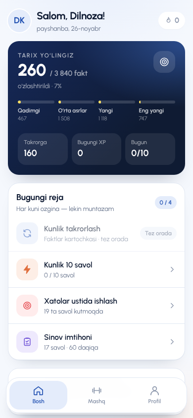
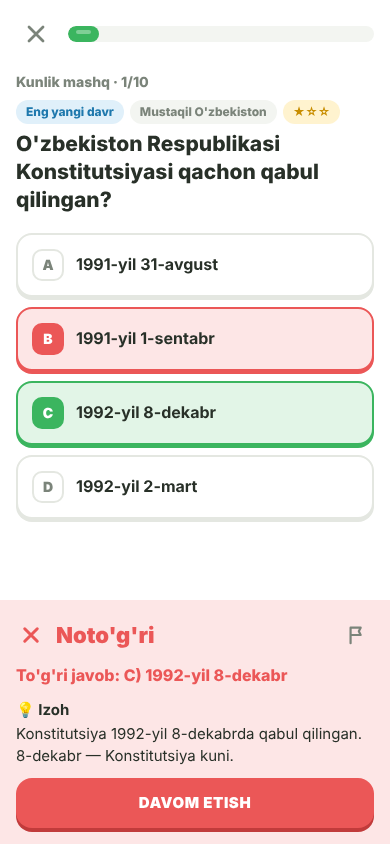
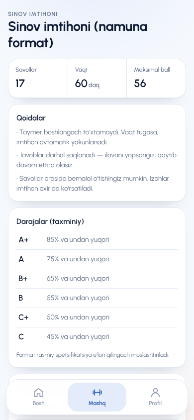
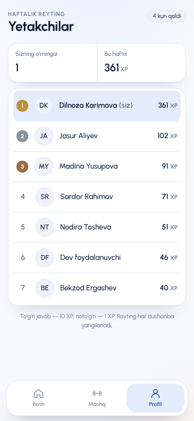
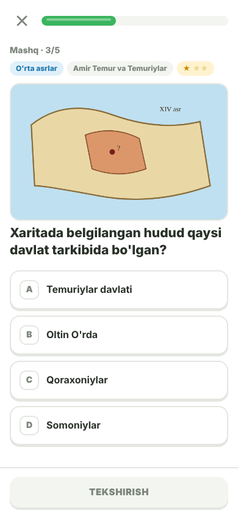
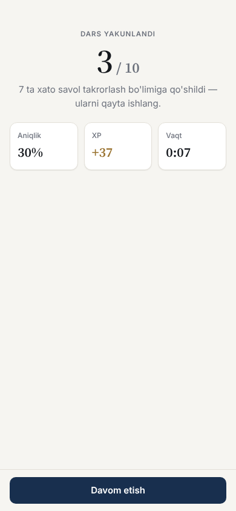
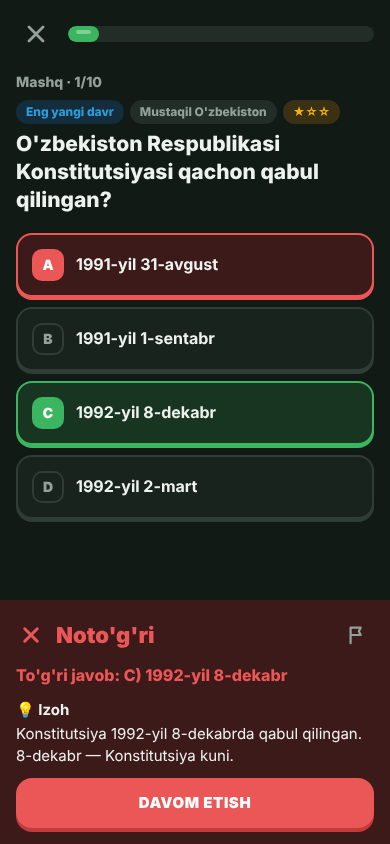
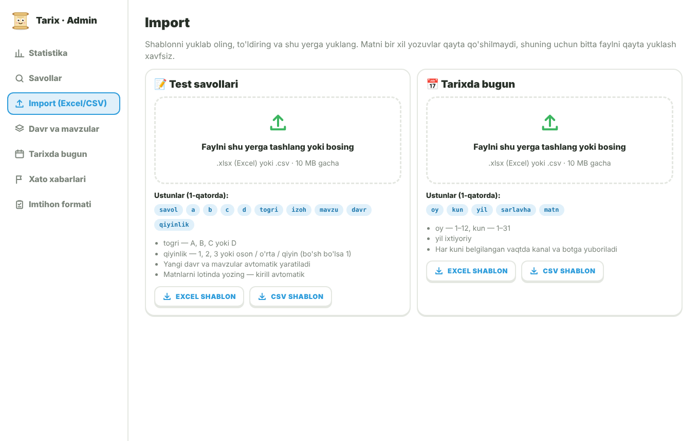
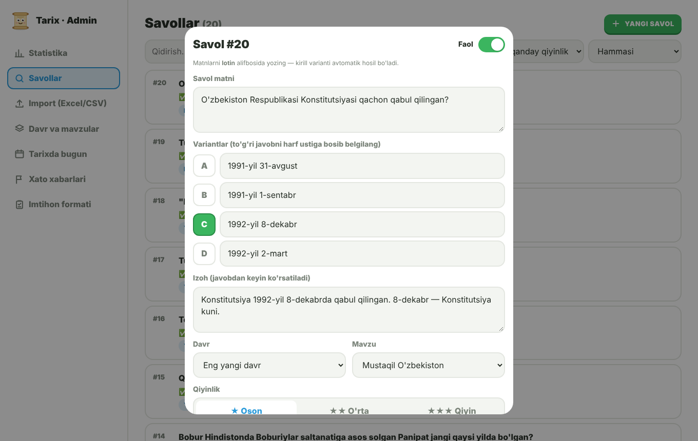
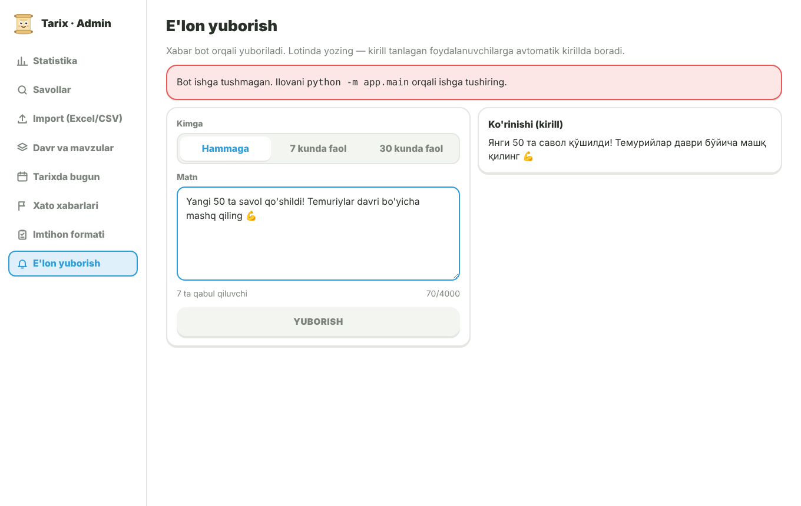

# Tarix — milliy sertifikatga tayyorgarlik 📜

Tarix fanidan milliy sertifikat imtihoniga tayyorlanuvchilar uchun **Telegram bot** va **Mini App**.
Ilova o'yin uslubida: XP ballari, ketma-ket kunlar, mavzular yo'li va haftalik reyting bor.
Interfeys o'zbek tilida.

| Bosh sahifa | Dars | Imtihon | Reyting |
|---|---|---|---|
|  |  |  |  |

| Rasmli savol | Natija | Qorong'i mavzu |
|---|---|---|
|  |  |  |

| Admin: import | Admin: savol tahriri | Admin: e'lon yuborish |
|---|---|---|
|  |  |  |

## Imkoniyatlar

**O'quvchi uchun (bot va Mini App):**
- 📝 Test mashqlari: aralash, davr bo'yicha yoki mavzu bo'yicha. Har javobdan keyin 💡 izoh ko'rsatiladi.
- 🔥 **Kunlik 10 savol**: avval takrorlash vaqti kelgan savollar, keyin yangilari. Ketma-ket kunlar hisoblanadi, har kuni 19:00 da eslatma keladi.
- 🔁 **Xatolar ustida ishlash** (oraliqli takrorlash): xato savol 1, 2, 4, 7, 15 va 30 kundan keyin qayta beriladi.
- 🎯 **Sinov imtihoni**: taymer bilan o'tadi. Natijada taxminiy ball, daraja va har bir savol tahlili ko'rsatiladi.
- 🏆 **Haftalik reyting**: to'g'ri javob uchun 10 XP, noto'g'ri javob uchun 1 XP beriladi.
- 📅 **Tarixda bugun**: har kuni 09:00 da kanalga va bot foydalanuvchilariga avtomatik post yuboriladi. Botda `/bugun` buyrug'i ham bor.
- 🖼 **Rasmli savollar** (xarita, portret, hujjat). Rasm bosilsa, kattalashadi.
- ⚠️ "Xato bor" tugmasi orqali savoldagi xato adminlarga darhol yetkaziladi. Bitta foydalanuvchi kuniga 20 tagacha xabar yubora oladi.

**Admin uchun (veb admin panel):**
- 📊 Statistika: foydalanuvchilar, faollik, aniqlik, davr va qiyinlik bo'yicha savollar soni.
- ❓ Savollar: qidirish, filtrlash, qo'shish, tahrirlash va o'chirish. Rasm yuklash mumkin.
- 📥 **Excel/CSV import** savollar va "Tarixda bugun" uchun. Shablonlarni paneldan yuklab olasiz.
- 💾 **Excel'ga eksport (zaxira nusxa)** import formatida: yuklab olasiz, tahrirlaysiz va qayta yuklaysiz.
- 📢 **E'lon yuborish**: hammaga yoki faqat faol foydalanuvchilarga.
- 🗂 Davr va mavzular: nomlash va tartiblash.
- 📅 "Tarixda bugun" voqealari: oy bo'yicha ko'rish, qo'shish va tahrirlash.
- ⚠️ Xato xabarlari: savolni shu yerning o'zida tuzatish mumkin.
- 🎯 **Imtihon formati**: savollar soni, ballar, qiyinlik va davr filtrlari, darajalar. Rasmiy spetsifikatsiya chiqqanda kodga tegmasdan shu yerda o'zgartirasiz.

---

## Qanday ishlaydi

```
                 ┌──────────────── bitta server (python -m app.main) ────────────────┐
 Telegram ──────►│  aiogram bot   ─┐                                                 │
                 │  APScheduler   ─┼──► services/ (biznes logika) ──► PostgreSQL/SQLite│
 Mini App ──────►│  FastAPI /api  ─┘                                                 │
 (React)         │  webapp/dist  (Mini App + admin panel fayllari)                   │
                 └───────────────────────────────────────────────────────────────────┘
```

Bot, Mini App API, admin panel va kunlik eslatmalar **bitta jarayonda** ishlaydi, shuning uchun serverga joylash oson.
Mantiq `services/` papkasida bir marta yozilgan, bot ham, Mini App ham undan foydalanadi.

---

## 1. Kompyuterda ishga tushirish

### Kerakli dasturlar
- **Python 3.12+**: https://www.python.org/downloads/ (Windows'da "Add Python to PATH" belgisini qo'ying)
- **Node.js 20+**: https://nodejs.org/ (Mini App'ni yig'ish uchun kerak)
- **Git**: https://git-scm.com/

### Bot tokeni
1. Telegramda **@BotFather** ga `/newbot` yozing va ko'rsatmalarga amal qiling. Oxirida token olasiz.
2. **@userinfobot** ga yozib, o'z Telegram ID raqamingizni bilib oling. Bu raqam sizni admin qiladi.

### O'rnatish
```bash
git clone https://github.com/ismatillayeveldurbek-lab/Tarix_ilova.git
cd Tarix_ilova

# Mini App'ni yig'ish (bir marta, va frontend o'zgarganda)
cd webapp
npm install
npm run build
cd ..

# Python qismi
cd backend
python -m venv .venv
.venv\Scripts\activate          # macOS/Linux: source .venv/bin/activate
pip install -r requirements.txt
copy .env.example .env          # macOS/Linux: cp .env.example .env
```
`backend/.env` faylini oching va `BOT_TOKEN` hamda `ADMIN_IDS` ni yozing. **Tokenni hech qachon kodga yozmang.**

```bash
alembic upgrade head            # jadvallarni yaratadi
python -m scripts.seed          # 20 ta namuna savol (sinash uchun). Faqat imtihon formati kerak bo'lsa: --faqat-format
python -m app.main              # bot + Mini App + admin panel
```
Endi Telegramda botingizga `/start` yozing.

### Mini App va admin panelni brauzerda ko'rish (Telegram'siz)
Telegram Mini App faqat **HTTPS** manzilda ochiladi. Kompyuterda sinash uchun esa "dev rejim" bor:
```bash
# backend/.env ichiga qo'shing (FAQAT kompyuterda!):
DEV_TELEGRAM_ID=sizning_ID_raqamingiz
```
Keyin `python -m app.main` ni ishga tushirib, brauzerda http://localhost:8000 ni oching.
Admin panel http://localhost:8000/#/admin manzilida.

> ⚠️ Serverga joylashda `DEV_TELEGRAM_ID` ni **0** qoldiring. Aks holda har kim admin bo'lib kira oladi.

Frontend'ni o'zgartirayotganda `webapp` papkasida `npm run dev` ni ishga tushiring. U o'zgarishlarni darhol ko'rsatadi: http://localhost:5173.

### Testlar
```bash
cd backend && pytest      # bot oqimi, API, imtihon, import, takrorlash...
```

---

## 2. Savollarni joylash

1. Telegramda botga **/panel** yozing (sizning ID raqamingiz `ADMIN_IDS` da bo'lishi kerak).
2. **"🖥 Brauzerda ochish"** tugmasini bosing. Admin panel kompyuterda ochiladi, havola 12 soat amal qiladi.
3. **Import** bo'limida **Excel shablon** ni yuklab oling va to'ldiring:

| savol | a | b | c | d | togri | izoh | mavzu | davr | qiyinlik | rasm |
|---|---|---|---|---|---|---|---|---|---|---|
| Amir Temur qaysi yilda tug'ilgan? | 1320 | 1336 | 1370 | 1405 | B | 1336-yil 9-aprelda... | Amir Temur va Temuriylar | O'rta asrlar | 1 | |

4. Faylni panelga tashlang. Natija darhol ko'rinadi: nechta savol qo'shildi, nechtasi takroriy chiqdi, qaysi qatorlarda xato bor.

Qoidalar:
- `togri` ustuniga A, B, C yoki D yoziladi.
- `qiyinlik` ustuniga 1, 2, 3 yoki `oson`, `o'rta`, `qiyin` yoziladi.
- `rasm` ixtiyoriy: rasmning `https://` havolasi. Rasmni keyin savolni tahrirlab yuklash ham mumkin.
- Bazada yo'q mavzu yoki davr avtomatik yaratiladi.
- Matni bir xil savol qayta qo'shilmaydi, shuning uchun bitta faylni qayta yuklash xavfsiz.
- "Tarixda bugun" uchun ustunlar: `oy | kun | yil | sarlavha | matn`.

Botga `.xlsx` yoki `.csv` faylni to'g'ridan-to'g'ri yuborsangiz ham import ishlaydi.

**Namuna savollarni o'chirish:** Admin panel → Savollar → savolni bosing → 🗑. Yoki bazani noldan yarating va `python -m scripts.seed --faqat-format` ni ishga tushiring.

---

## 3. Serverga joylash (Railway misolida)

Mini App ishlashi uchun ilova internetda **HTTPS** manzilga ega bo'lishi kerak.

1. https://railway.app da ro'yxatdan o'ting va **New Project → Deploy from GitHub repo** orqali shu repozitoriyni tanlang. Railway `Dockerfile` ni o'zi topadi.
2. Loyihaga **PostgreSQL** qo'shing: **New → Database → PostgreSQL**.
3. Ilova xizmatining **Variables** bo'limiga quyidagilarni kiriting:
   ```
   BOT_TOKEN=...
   ADMIN_IDS=...
   DATABASE_URL=${{Postgres.DATABASE_URL}}
   CHANNEL_ID=@kanalingiz          # "Tarixda bugun" uchun. Bot kanalda admin bo'lishi kerak
   WEBAPP_URL=https://<railway bergan domen>
   PORT=8000
   ```
4. **Settings → Networking → Generate Domain** orqali domen oling, so'ng uni `WEBAPP_URL` ga yozing.
5. Ilova qayta ishga tushganda bot avtomatik ravishda quyidagilarni qo'shadi:
   - chat pastidagi **"📱 Ilova"** tugmasi;
   - menyudagi **"📱 Ilovani ochish"** tugmasi.

Ilova har safar ishga tushganda jadvallarni o'zi yangilaydi (`alembic upgrade head`), namuna savollarni esa **yuklamaydi**.
Boshqa xosting (Render, VPS) uchun ham shu `Dockerfile` ishlaydi.
Kompyuterda PostgreSQL bilan sinash uchun: `docker compose up --build`.

---

## Loyiha tuzilmasi

```
├── Dockerfile, docker-compose.yml
├── backend/
│   ├── .env.example            # sozlamalar namunasi
│   ├── alembic/                # baza migratsiyalari
│   ├── app/
│   │   ├── main.py             # TO'LIQ ilova: bot + API + eslatmalar
│   │   ├── config.py, db.py, security.py
│   │   ├── models/             # jadvallar
│   │   ├── services/           # mantiq: quiz, review, exam, rating, daily, history, importer...
│   │   ├── bot/                # Telegram bot: handlers/, texts.py, scheduler.py
│   │   └── api/                # FastAPI: routes/app_routes.py (Mini App), routes/admin.py
│   ├── data/                   # namuna savollar va voqealar
│   ├── scripts/seed.py
│   └── tests/
└── webapp/                     # Mini App + admin panel (React + TypeScript)
    └── src/
        ├── pages/              # Home, Lesson, Exam, Rating, Profile, admin/*
        ├── components/         # Mascot (ilova qahramoni), Icons, ui
        └── lib/                # api, telegram, router, store
```

## Kelajak uchun tayyor
- **Premium (Click/Payme):** `users.premium_until` maydoni bor. To'lov webhook'lari `api/routes/` ga yangi fayl sifatida qo'shiladi.
- **Referal tizimi:** `users.referred_by` maydoni bor. `/start <kod>` deep-link orqali ishlaydi.
- **Mavzular bo'yicha o'zlashtirish foizi:** `answers` jadvalidan hisoblanadi. Mini App'da mavzu tugunlari allaqachon progressni ko'rsatadi.
- **AI yordamchi va o'yin rejimlari:** yangi `services/` moduli va yangi sahifa sifatida qo'shiladi.
